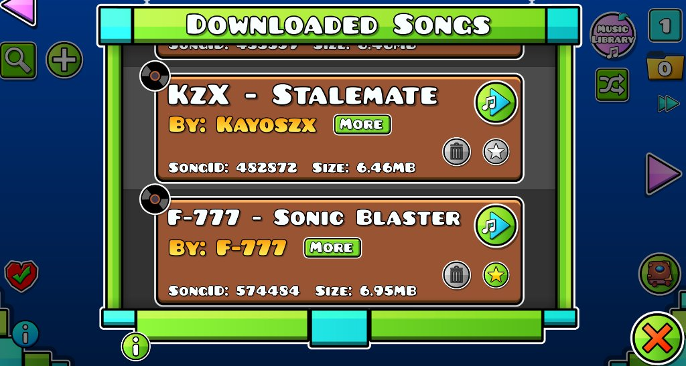
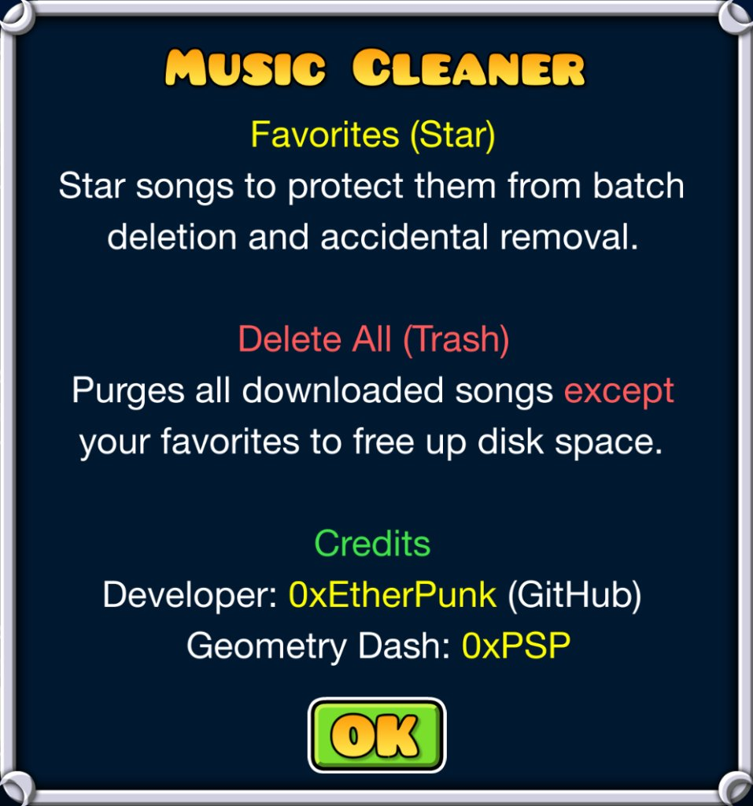
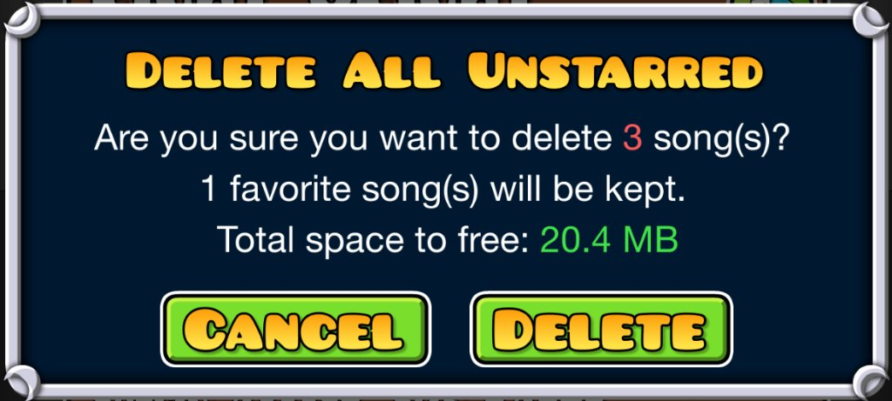

# Music Cleaner

| Mod Icon | Quick Access Button |
|:---:|:---:|
| <br>**Music Cleaner** | <br>**Located in Saved Levels** |

### Downloaded Songs Interface

<p align="center">
  
</p>

- **Star Button (`★`):** Marks a song as favorite, protecting it from both individual and batch deletion.
- **Trash Button (`🗑`):** Deletes that specific song individually (only works on unstarred tracks).
- **Red Cross Button (`❌`):** Located in the bottom-right corner. Deletes all unstarred songs at once after confirmation.
- **Info Button (`(i)`):** Opens a quick help dialog showing usage rules and developer credits.

---

| Parameter | Specification |
|:---|:---|
| **Author** | [0xEtherPunk](https://github.com/0xEtherPunk) |
| **Geometry Dash** | `0xPSP` |
| **Repository** | [Music-Cleaner](https://github.com/0xEtherPunk/Music-Cleaner) |
| **License** | [MIT](LICENSE) |
| **Tags** | `Music`, `Online`, `Utility`, `Interface` |
| **Compatibility** | Geode SDK v5.11.2 (Geometry Dash 2.2081) |

---

**Music Cleaner** is a Geometry Dash mod (Geode) that lets you batch delete downloaded custom songs to reclaim disk space, while protecting your favorite tracks with a star whitelist.

## How to Use

1. **Star songs you want to keep:** Click the star icon on any level page or in the song browser.
2. **Open the song browser:** Go to Saved Levels and click the music button next to the folders button.
3. **Delete all unstarred tracks:** Click the red cross button `(X)` in the bottom-right corner. A confirmation dialog will show the number of songs to delete, preserved favorites, and exact disk space to be freed (MB/GB).
4. **Delete tracks individually:** Click the trash icon on any song row to delete only that track.
5. **Accidental deletion protection:** Starred tracks cannot be deleted individually or in bulk until manually unstarred.

## Interface Integration

- **Saved Levels (`LevelBrowserLayer`):** Quick access music button next to the folder button.
- **Downloaded Songs Browser (`GJSongBrowser` & `CustomSongCell`):**
  - Star button placed under the playback button.
  - Trash button placed beside the star button on the same line for single-track deletion.
  - Red cross button in the bottom-right corner for batch deletion of all unstarred songs.
  - Info button `(i)` below the bottom-left corner of the dialog frame.
- **Level Page (`CustomSongWidget`):** Star button next to the download/delete button to favorite songs directly from levels.

## In-Game Dialogs

| Information & Help Dialog | Safe Batch Deletion Confirmation |
|:---:|:---:|
| <br>**Info & Credits Dialog**<br>Accessible via the `(i)` button below the song browser frame. | <br>**Confirmation Dialog**<br>Shows songs to delete, kept favorites count, and exact space to be freed. |

## Project Structure

```
Music-Cleaner/
├── CMakeLists.txt                 # CMake configuration with automatic git tag versioning
├── mod.json                       # Geode mod manifest
├── logo.png                       # High-resolution mod icon with transparent rounded corners
├── saved-levels-btn.png           # Saved levels entry button preview
├── song-browser.png               # Downloaded songs interface preview
├── info-popup.png                 # Info and credits popup preview
├── delete-confirm-popup.png       # Confirmation popup preview
├── LICENSE                        # MIT License
├── about.md                       # In-game Geode Index description
└── src/
    ├── main.cpp                   # Mod entrypoint and lifecycle events
    ├── MusicCleaner.hpp           # Core whitelist storage and filesystem calculation logic
    ├── MusicCleaner.cpp
    └── hooks/
        ├── CustomSongCellHook.cpp     # Track row favorite star and delete button alignment
        ├── CustomSongWidgetHook.cpp   # Level view compact star toggle and USE button suppression
        ├── GJSongBrowserHook.cpp      # Batch deletion, info button, and menu music restoration
        └── LevelBrowserLayerHook.cpp  # Saved Levels browser entrypoint button
```

## Building

### Requirements
- Geode CLI (`geode-cli 4.0.0+`)
- CMake 3.25+
- Clang 19+ (or platform toolchain)
- Geode SDK v5.11.2+

### Compilation
```bash
geode build -p windows
```

The build system automatically synchronizes `mod.json` version metadata with the latest Git tag (`git describe --tags --abbrev=0`).

### Installation
Copy the compiled `.geode` package into your Geometry Dash `geode/mods/` directory:
```bash
cp build-win/0xetherpunk.music-cleaner.geode "$STEAM_GD/geode/mods/"
```

## License

[MIT License](LICENSE)
